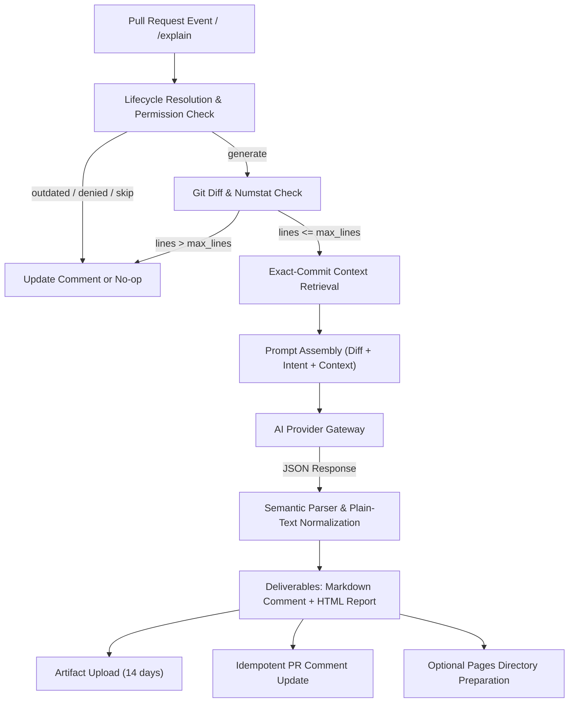

# PR Explainer AI

> **Understanding is the new bottleneck.**

Pull requests are where software changes hands. Yet reviews often ask engineers to reconstruct intent from fragmented diffs, sparse descriptions, and hidden file dependencies.

**PR Explainer AI** transforms pull requests into an editorial, standalone technical understanding experience: why the change exists, how the system behaves, which code paths matter, ground-truth evidence separation, and an adaptive interactive quiz and scenario explorer.

---

## Key Features

- **Multi-Provider AI Architecture**: Direct support for 6 providers — **OpenRouter** (default), **Featherless**, **OpenAI**, **Anthropic** (Claude), **xAI** (Grok), and **Google Gemini** — with full backward compatibility for existing OpenRouter configurations.
- **Evidence & Trust Separation**: Clearly distinguishes between behavior verified by code/tests, author-stated intent from the PR description, and unverified assumptions or external system unknowns.
- **Exact-Commit Context Retrieval**: Detects referenced local scripts in added workflow steps and reads them from the analyzed Git commit with `git cat-file`, not from the mutable pull-request workspace. Symlinks, traversal, sensitive paths, binaries, and oversized files are rejected.
- **Controlled Rendering**: Model output is normalized to plain text and escaped by the renderer. Raw model HTML, scripts, and event-handler attributes are never injected into the report. A nonce-based CSP and self-contained assets replace external CDN dependencies.
- **Editorial Experience**: Refined editorial aesthetic (Linear / Geist / Primer inspired) with light paper warmth, dark mode support, fluid typography, and zero mandatory external CDN dependencies.
- **Interactive Scenario Explorer & Adaptive Quiz**: Interactive rule/error evaluation and adaptive quizzes (0 to 5 questions scaled to PR complexity with dynamic score tracking).
- **Dual Deliverables for Public & Private Repos**:
  - **In-PR Markdown Comment**: Idempotently updated summary with evidence breakdown, persisting technical clarity directly in the PR thread even when artifacts expire.
  - **Standalone Interactive HTML Artifact**: Attached to the GitHub Actions run with configurable retention.
  - **Optional Pages Preparation**: `publish_pages` writes a ready-to-deploy directory under `pr-explains/pr-<number>/` and uploads it as an artifact. The Action does **not** deploy, publish, or infer a public URL. A Pages link is added only when `pages_deployment_url` is explicitly supplied as an already-confirmed `https://` URL.
- **Safe Lifecycle & `/explain` Trigger**: Generates on `opened`, `reopened`, and `ready_for_review`; marks an existing explanation as outdated on `synchronize`/`edited` without re-running inference; posts a skip notice when the diff exceeds `max_lines`; and supports manual `/explain` requests verified against `write`, `maintain`, or `admin` repository permission.

---

## Quick Start

Use `pull_request_target` for public repositories so the workflow can read the base repository and comment with a write-capable token. The Action reads the PR head only as Git objects; it never checks out or executes pull-request code.

```yaml
name: explain-pr

on:
  pull_request_target:
    types: [opened, reopened, ready_for_review, synchronize, edited]
  issue_comment:
    types: [created]

concurrency:
  group: pr-explainer-${{ github.event.pull_request.number || github.event.issue.number }}
  cancel-in-progress: false

jobs:
  explain:
    if: |
      github.event_name == 'pull_request_target' ||
      (github.event_name == 'issue_comment' &&
       github.event.issue.pull_request &&
       startsWith(github.event.comment.body, '/explain'))
    runs-on: ubuntu-latest
    permissions:
      contents: read
      pull-requests: write
      issues: write

    steps:
      # Checks out the trusted base branch. Do NOT check out the PR head here:
      # pull_request_target has access to secrets and must not run fork code.
      - uses: actions/checkout@v7
        with:
          fetch-depth: 0

      - uses: rafaeltorresng/pr-explainer-action@v1
        with:
          openrouter_api_key: ${{ secrets.OPENROUTER_API_KEY }}
          language: en # or pt-BR
```

> **Security note:** `pull_request_target` workflows run with the base repository's secrets. Never add `ref: ${{ github.event.pull_request.head.sha }}` to the checkout, and never run install/build/test commands from the PR head in this workflow. PR Explainer only reads the diff and referenced blobs through Git; it does not execute repository code.

### Multi-Provider Examples

#### OpenAI
```yaml
      - uses: rafaeltorresng/pr-explainer-action@v1
        with:
          ai_provider: openai
          ai_api_key: ${{ secrets.OPENAI_API_KEY }}
          ai_model: gpt-4o-mini
```

#### Anthropic (Claude)
```yaml
      - uses: rafaeltorresng/pr-explainer-action@v1
        with:
          ai_provider: anthropic
          ai_api_key: ${{ secrets.ANTHROPIC_API_KEY }}
          ai_model: claude-3-5-sonnet-20241022
```

#### Featherless
```yaml
      - uses: rafaeltorresng/pr-explainer-action@v1
        with:
          ai_provider: featherless
          ai_api_key: ${{ secrets.FEATHERLESS_API_KEY }}
          ai_model: meta-llama/Meta-Llama-3.1-8B-Instruct
```

#### Google Gemini
```yaml
      - uses: rafaeltorresng/pr-explainer-action@v1
        with:
          ai_provider: gemini
          ai_api_key: ${{ secrets.GEMINI_API_KEY }}
          ai_model: gemini-1.5-flash
```

#### xAI (Grok)
```yaml
      - uses: rafaeltorresng/pr-explainer-action@v1
        with:
          ai_provider: xai
          ai_api_key: ${{ secrets.XAI_API_KEY }}
          ai_model: grok-beta
```

---

## Configuration Reference

### Inputs

| Input | Default | Purpose |
| --- | --- | --- |
| `ai_provider` | `openrouter` | AI provider (`openrouter`, `featherless`, `openai`, `anthropic`, `xai`, `gemini`). |
| `ai_api_key` | `""` | Generic API key for the chosen provider. |
| `ai_model` | `""` | Model identifier override for the chosen provider. |
| `ai_base_url` | `""` | Custom API base URL override (for self-hosted or proxy gateways). |
| `openrouter_api_key` | `""` | OpenRouter API key (legacy input, preserved for backward compatibility). |
| `openrouter_model` | `deepseek/deepseek-v4-flash` | OpenRouter model identifier (legacy input). |
| `mode` | `auto` | Lifecycle mode: `auto`, `generate`, `outdated`, or `skip`. `auto` resolves pull-request and `/explain` events; `generate` is intended for CI/dry runs and cannot bypass `/explain` authorization. |
| `language` | `en` | `en` (English) or `pt-BR` (Brazilian Portuguese). |
| `enable_context_retrieval` | `true` | Retrieve referenced scripts from the analyzed commit. |
| `max_context_files` | `2` | Maximum number of additional repository files to read. |
| `max_context_bytes` | `8192` | Maximum total bytes of additional context (8 KB). |
| `max_lines` | `15000` | Post a skip notice instead of generating when the diff exceeds this number of changed lines. |
| `comment_on_pr` | `true` | Post/update an idempotent Markdown comment on the pull request. |
| `publish_pages` | `false` | Prepare a local `pages-dist` directory for later publication. Does not deploy. |
| `pages_output_dir` | `pages-dist` | Directory used when `publish_pages` is enabled. |
| `pages_deployment_url` | `""` | Optional already-confirmed `https://` URL. Only used to link the PR comment; the Action does not deploy. |
| `output_file` | `pr-explanation.html` | Generated interactive HTML filename. |
| `markdown_output_file` | `pr-explanation.md` | Generated Markdown comment filename. |
| `artifact_name` | `pr-explanation-html` | Artifact name uploaded to GitHub Actions. |
| `retention_days` | `14` | Days to retain the uploaded artifact. |
| `base_ref` | `""` | Base ref used for diff comparison (defaults to the target PR branch). |
| `github_token` | `${{ github.token }}` | GitHub token with permission to comment on the pull request. |

### Outputs

| Output | Description |
| --- | --- |
| `lifecycle_mode` | Resolved mode: `generate`, `outdated`, `denied`, or `skip`. |
| `pr_number` | Pull request number resolved from the event. |
| `should_run` | Whether generation should run after the diff checks (`true` / `false`). |
| `lines_changed` | Added plus deleted lines counted from the Git diff. |
| `commit_sha` | Head commit SHA analyzed. |
| `provider_used` | Provider that handled the request. |
| `model_used` | Model identifier used. |
| `tokens_used` | Total prompt + completion tokens used. |
| `context_files_count` | Number of selective context files inspected. |
| `artifact_name` | Name of the uploaded artifact. |
| `markdown_output_file` | File path of the generated Markdown summary. |
| `pages_output_file` | Path to the prepared Pages `index.html`, when `publish_pages` is enabled. |

---

## Lifecycle Behavior

| Event | Resolved mode | Effect |
| --- | --- | --- |
| `pull_request_target.opened`, `reopened`, `ready_for_review` | `generate` | Runs inference and comments. |
| `pull_request_target.synchronize`, `edited` | `outdated` | Prepends an outdated warning to the existing comment. No inference. |
| `issue_comment.created` with `/explain` from a `write`/`maintain`/`admin` user | `generate` | Runs inference for the current PR head. |
| `issue_comment.created` with `/explain` from an unauthorized user | `denied` | Posts a permission notice. No inference. |
| Diff exceeds `max_lines` | `generate` → skip | Posts a skip notice and preserves the last valid explanation. |
| Unsupported event/action | `skip` | No-op. |

---

## Architecture & Trust Model



1. **Untrusted Data Boundary**: Diff content, author descriptions, and model output are untrusted. Model HTML is converted to plain text, and every rendered field is escaped. Reports use a nonce-based CSP, `default-src 'none'`, and no external scripts, styles, or fonts.
2. **Context Safety**: Referenced files are resolved from the exact analyzed commit with `git cat-file`. Path traversal, absolute paths, symlinks, submodules, binary blobs, sensitive filenames, and files above the context budget are rejected. The mutable workspace is used only when no commit SHA is available.
3. **Comment Safety**: Markdown control characters, mentions, URLs, and link syntax from model text are neutralized before posting.
4. **Resilience**: Transient AI-provider errors (429, 500, 502, 503, 504) are retried with exponential backoff and jitter, respecting `Retry-After`. Permanent errors (400, 401, 403, 404) fail fast.

---

## Local Verification

The repository includes unit, contract, mock-provider, and Action-lifecycle tests:

```bash
bun test
```

The suite exercises the real parser, renderer, context retriever, GitHub client, and `runAction` lifecycle paths. Provider responses are fixed fixtures, so these tests validate the pipeline and rendering, **not** whether a real model would produce correct content for an unseen PR. See [`docs/review-limitations.md`](docs/review-limitations.md) for the validation boundaries and the remaining known risks.

---

## License

MIT © Rafael Torres
