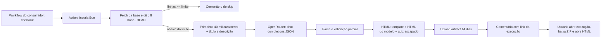

# PR Explainer AI — descoberta de produto e auditoria técnica

Data da investigação: 9 de novembro de 2026. Base: checkout local `main`, commit `1da5f69`, tags `v1` e `v1.1.0`; `origin/main` é a referência local, sem fetch durante a auditoria. Havia um `.DS_Store` não rastreado. Não se conclui, sem consultar o remoto, que não haja commits ou releases mais recentes no servidor.

## A. Executive summary

O produto tem uma proposta promissora: transformar mudanças de código em conhecimento compartilhável, com uma experiência deliberadamente didática. Há uma Action pequena, sem dependências de runtime instaladas pelo projeto, prompts bilíngues, artefato HTML com quiz, controle de tamanho e testes. O projeto já demonstra cuidado com tom didático, intenção declarada versus evidência e tratamento de erros.

As lacunas mais importantes estão antes do redesign: **HTML do modelo é inserido sem sanitização**, o diff é cortado silenciosamente nos primeiros 40.000 caracteres e a validação aceita explicações quase vazias. O resultado pode parecer completo e confiável sem ser. A entrega também exige baixar um artefato temporário; comentários se acumulam e não identificam claramente o commit explicado. A geração força cinco questões mesmo em mudanças simples.

Recomendação: direcionar o produto para **compreensão verificável de uma mudança**, com visão rápida e aprofundamento opcional, evidências navegáveis, limites explícitos e aprendizado como camada adicional. Primeiro estabelecer segurança e um pequeno conjunto de avaliação; em seguida experimentar uma renderização semântica e distribuição proporcional ao caso de uso. Featherless cabe em uma extensão pequena. Gist não atende sozinho à experiência HTML nem à privacidade.

## B. Current product reality

- Confirmado no código: Action composite, Bun, OpenRouter, inglês e português, diff Git, HTML e quiz, artifact de 14 dias, comentário novo por execução e três tentativas de inferência. O próprio workflow de dogfood só reage a `opened` e `reopened`; o exemplo do README inclui `synchronize`. Nenhum deles exclui drafts.
- O README chama o resultado de durável e diz que a Action gera um artifact para cada PR. Retenção de 14 dias, limite, falhas e restrições de forks tornam isso mais restrito. Ele descreve o link como para o artifact, mas aponta para a página da execução.
- A tag local `v1.1.0` aponta para o merge que incorporou descrição do PR, datado de 17/07/2026 no fuso do commit. A [página pública de releases](https://github.com/rafaeltorresng/pr-explainer-action/releases) identifica `v1.1.0` como latest e mostra publicação em 18/07; não foi feito fetch das branches remotas.
- Hipótese de produto, não evidência: revisores e pessoas em onboarding podem valorizar explicações navegáveis mais que um sumário. Não há telemetria, pesquisa de usuário ou benchmark no repositório que prove adoção, utilidade ou qualidade.

## C. End-to-end architecture

O consumidor escolhe o evento, permissões e checkout; a Action não controla esses pontos. A base é `base_ref`, depois `github.base_ref`, depois `main`. Faz fetch de `origin BASE_REF` e compara `origin/BASE_REF...HEAD` via merge-base. O checkout padrão de `pull_request` normalmente é o commit de merge sintético, e não necessariamente o SHA da ponta; a base é a ponta atual obtida no fetch, que pode mudar entre evento e execução. Não há captura explícita dos SHAs do evento ou registro deles no relatório. O comportamento em cenários de base avançando, merge sintético e concorrência requer testes de integração.

`git diff` usa as opções padrão do Git: trata adições e remoções normalmente, rename detection depende da configuração/default do Git, binários aparecem com indicação binária e numstat `-`; eles contam zero linhas. Não há seleção especial para testes, docs, infra, configuração, vários arquivos, grandes arquivos ou mudanças centrais. O corte é uma substring UTF-16, não bytes nem tokens, podendo cortar no meio de hunk ou caractere composto. Não marca a omissão nem fornece inventário dos arquivos omitidos. Arquivo de diff vazio passa pelo gate de linhas e falha depois. Alterações apenas binárias podem ser enviadas apesar de contar zero linhas.

## D. Feature & configuration inventory

| Contrato | Estado atual |
|---|---|
| `openrouter_api_key` | obrigatório; secret fornecido pelo consumidor |
| `openrouter_model` | `deepseek/deepseek-v4-flash` |
| `language` | `en` default; `pt-BR`; código aceita aliases `en-us`, `pt`, `pt-br`, `pt_br` |
| `max_lines` | `15000`, aplicado como `lines_changed < max_lines`, logo igualdade também é ignorada apesar de mensagem dizer excede |
| `output_file` / `artifact_name` | `pr-explanation.html` / `pr-explanation-html` |
| `base_ref` | opcional; omitido da tabela do README |
| `comment_on_pr` | `true`, comparação textual exata |
| outputs | `should_run`, `lines_changed`, `artifact_name`; não há URL, SHA, custo ou estado de truncamento |
| implícitos | limite de 40.000 caracteres, timeout 300 s por fetch, até 3 tentativas, delays de 2 e 4 s, retenção 14 dias, cinco perguntas desejadas |

GitHub requer checkout e histórico suficientes; README pede `fetch-depth: 0`, `contents: read` e `pull-requests: write` para comentar. Sem comentário, write não é necessário. A Action não define gatilho, nem verifica draft. Em PR de fork, secrets comuns são omitidos e token normalmente é somente leitura; a geração falha sem key e comentário não tem permissão. Políticas de organização e Dependabot também importam. Veja [eventos de fork](https://docs.github.com/en/actions/reference/workflows-and-actions/events-that-trigger-workflows) e [segurança de `pull_request_target`](https://docs.github.com/en/actions/reference/security/securely-using-pull_request_target). Não substituir simplesmente o evento para obter secrets. O dogfood usa `uses: ./`, portanto executa a Action do checkout do próprio PR; isso é adequado apenas dentro do modelo de confiança aplicável.

Na publicação, falha na geração impede upload e comentário de sucesso; falha de upload impede comentário posterior; falha ao comentar pode deixar artifact criado e job falho. Não há comentário de falha, atualização, limpeza, lock, concurrency group ou tratamento explícito de reruns. A retenção é limitada pelas políticas do repositório/organização; [GitHub documenta](https://docs.github.com/en/repositories/managing-your-repositorys-settings-and-features/enabling-features-for-your-repository/managing-github-actions-settings-for-a-repository) máximos configuráveis dependentes da visibilidade e da organização. Deletar a execução pode remover seu artifact. Um relatório antigo não indica se ainda corresponde ao PR atual.

## E. Implementation assessment

`action.yml` concentra coleta, publicação e comentários; `explain-pr.js` concentra contexto, prompt, transporte, parsing, normalização, custo e renderização. Para o tamanho atual, divisão pequena por responsabilidade pode facilitar testes; uma plataforma genérica seria excessiva. O mock de arquivo cobre a renderização sem rede. CI roda testes e um fluxo composite com mock, porém não testa publicação real, fork, autenticação, corrida, semântica de diff, navegador ou qualidade do modelo.

**Segurança prioritária:** `background`, `intuition`, `diagrams` e `codeWalkthrough` são HTML arbitrário inserido diretamente no documento (`explain-pr.js:625–644`). Título e texto do quiz são escapados, mas isso não protege os campos HTML. Uma resposta maliciosa, inclusive induzida pelo conteúdo do PR, pode inserir scripts, handlers, links ou recursos externos; o impacto depende de onde e como o documento é aberto/publicado. Não foi executado payload ativo. Publicar HTML ativo em origem compartilhada amplia consequências e deve esperar correção e avaliação da origem. O prompt separa papéis e diz para confiar no diff, mas diff e descrição podem conter instruções adversariais; delimitadores não garantem isolamento. O modelo não tem ferramentas, portanto a capacidade direta é limitada à resposta e ao conteúdo gerado, mas não há defesa suficiente contra instruções que mudem o relatório.

O diff e a descrição completos dentro dos limites são enviados ao provedor, inclusive potenciais segredos e código privado; não há redaction nem aviso explícito de consentimento de envio. A resposta inválida registra os primeiros 500 caracteres e respostas HTTP podem ser impressas integralmente, podendo vazar conteúdo em logs. Não há CSP; CDN de Tailwind executa script e fontes são externas. Actions são referenciadas por tags móveis, não SHAs. Inputs são interpolados diretamente em código JavaScript do `github-script`; se forem controlados por fonte não confiável, aspas podem alterar o script. No exemplo são configurados pelo mantenedor, portanto não presumir exploração remota automática.

Resiliência: todas as falhas, inclusive 401/400 e erro de formato, são repetidas sem jitter ou `Retry-After`, até três chamadas. Timeout é cancelado após `fetch` retornar headers, antes de consumir o corpo: não limita necessariamente leitura do body. Não há limite de output, medição de duração ou orçamento. `finish_reason` não é verificado. Mensagens de erro misturam português e inglês. `max_lines` inválido pode falhar no shell; `output_file` pode afetar arquivos do workspace e padrões do upload, devendo ser configurado por usuário confiável.

## F. Generated experience review

Foram gerados `/tmp/pr-explainer-audit-en.html` e `/tmp/pr-explainer-audit-pt.html` com `sample.patch`, `event.json` e `mock.json`, usando key fictícia. O mock é deliberadamente trivial e não é uma amostra de qualidade da IA. O browser bloqueou `file://` por política de segurança e proibiu contorno; portanto não foi possível testar clique, layout responsivo ou capturar novos screenshots. A referência visual disponível é [a imagem versionada](../../public/artifact-preview.png), um recorte vertical da navegação lateral, não uma visão completa do relatório. Não há base para afirmar que o resultado foi visualmente testado em mobile.

Pelo template e imagem, a linguagem é editorial escura com serifas, acento roxo, navegação numerada e mascote animado. Há identidade e uma divisão clara em seções; o cabeçalho genérico e a sequência fixa não dão ao leitor uma resposta imediata sobre impacto, risco ou onde começar. O texto das seções e os diagramas dependem inteiramente da saída do modelo. Se houver menos perguntas válidas, a UI continua afirmando cinco e usa denominador 5; zero questões ainda deixa seção vazia. No código há feedback por alternativa, reset por questão, pontuação na sidebar e reação do mascote, mas interações não foram testadas no navegador.

A navegação lateral é `hidden lg:block`: em telas menores não há navegação equivalente explícita. O template usa estilos CDN, fontes externas e scripts inline; apesar dos assets base64, não é plenamente autossuficiente offline. Cada template ocupa ~629 KB e difere em cerca de 26 linhas textuais, duplicando estrutura, lógica e assets. O modelo precisa emitir classes Tailwind e HTML específico, acoplando apresentação à geração. O quiz possui botões e atributos ARIA, mas não foi auditado com leitor de tela, teclado ou contraste. Há animação e troca periódica de fundo sem evidência de respeito a `prefers-reduced-motion`; é um risco a validar.

Direção de redesign a testar: cabeçalho com propósito, alterações principais e escopo/limites; mapa de fluxo apenas quando útil; walkthrough ordenado pelo comportamento, com evidências apontando para SHA/arquivo/linha; detalhes e quiz sob demanda. Marcar exemplos sintéticos, incerteza e cobertura; não sugerir que HTML bem acabado significa evidência. Substituir HTML arbitrário por dados semânticos e componentes determinísticos, mantendo blocos limitados para prosa/código. Diagramas com esquema simples de nós/arestas ou antes/depois podem ser renderizados sem depender de HTML arbitrário; comparar com uma solução textual quando o diagrama não agrega. Não adotar framework por padrão.

### Amostra de explicações reais do repositório `app`

A pedido do usuário, foram baixados e inspecionados textualmente três artifacts privados ainda disponíveis, sem alterar o outro checkout. A comparação é pontual, não representa um benchmark. Os PRs e arquivos permanecem privados; os HTMLs foram mantidos apenas em `/tmp/pr-explainer-real-audit/`.

- [PR 3010](https://github.com/SantanaInteligencia/app/pull/3010), tratamento de falhas HTTP: a explicação identificou corretamente a condição `knownRejection`, o estado `unknown` e o teste de não repetir. Porém afirma como fato que toda resposta 4xx sem usage indica ausência de consumo. O código apenas aplica essa regra; ausência de usage não prova ausência de processamento ou cobrança. O texto também perdeu acentuação em grande parte. Este caso mostra valor real de explicar a invariante, mas também como uma hipótese do código pode virar certeza indevida.
- [PR 3008](https://github.com/SantanaInteligencia/app/pull/3008), política de deploy: o relatório afirma repetidamente que o comando adicional faz redeploy imediato do worker, e constrói diagrama e quiz sobre isso. O diff só chama um script; a descrição fala em atualizar a política pelo grafo de imports. A leitura do script no SHA do PR mostra PATCH da configuração e verificação, sem chamada direta de deploy. Portanto a narrativa central não é sustentada e contraria o propósito declarado. O exemplo demonstra erro factual propagado em todas as seções, com aparência de certeza. Uma questão também inventa a motivação da decisão arquitetural; outra converte testes relatados pelo autor em prova de que nada quebrou.
- [PR 3013](https://github.com/SantanaInteligencia/app/pull/3013), alteração visual: relatório identifica corretamente fonte, logo e paleta alterados, mas apresenta como garantido que o PDF continuará idêntico à tela. A descrição o declara como intenção e lista verificação manual ainda não marcada; o diff inclui um PDF binário, cuja equivalência não é demonstrada pelo texto. O quiz é predominantemente recordação de detalhes visuais, não aprofundamento de uma mudança técnica. O walkthrough usa trechos abreviados com reticências, sem marcar claramente que são paráfrases.

Nos exemplos 3008 e 3010, strings como `<code>...</code>` aparecem literalmente no quiz porque o modelo gerou marcação, enquanto a aplicação escapa esse texto: falha de apresentação do contrato. As amostras reforçam a prioridade de evidências e contexto seletivo: no 3008, ler o script chamado seria mais útil que enviar mais diff indiscriminadamente; mesmo assim, objetivos operacionais e efeitos reais devem ser apresentados com cautela. Não foi possível abrir os documentos no navegador por causa da política já mencionada.

## G. AI pipeline assessment

Prompt de sistema instrui saída JSON, conteúdo didático, diagramas HTML, walkthrough e cinco questões. Usuário contém título, número, descrição opcional e diff; descrição é explicitamente intenção do autor. `response_format: json_object`, temperatura 0,1, sem limite explícito de geração. Parse remove fences; tentativa de reparar truncamento serve para identificar erro, mas rejeita o resultado reparado. Validação aceita apenas um dos quatro campos essenciais não vazio, sem exigir string ou quiz válido; `normalizeQuiz` ignora questões inválidas e limita a cinco. Logo o README exagera ao dizer que respostas incompletas são rejeitadas. HTML válido não implica fidelidade nem segurança.

Há logs de tokens apenas para a chamada final, sem custo das tentativas anteriores. Estimativa hardcoded para o modelo default: entrada US$ 0,09 e saída US$ 0,18 por milhão; outros modelos exibem `n/a`. Valores podem estar desatualizados, ignoram cache, variação de provedor e retries. Não há evidência para garantir US$ 0,001 por explicação; usar custo reportado pelo provedor quando disponível e, caso contrário, exibir estimativa versionada com ressalvas. Em 09/11/2026, a [página OpenRouter](https://openrouter.ai/deepseek/deepseek-v4-flash) exibia US$ 0,05 de entrada e US$ 0,45 de saída por milhão, diferente dos US$ 0,09/0,18 embutidos; roteamento, cache e tarifas podem variar. Confirmar custo efetivo por request.

Diff pode ser suficiente para uma mudança autocontida, com contexto do hunk e testes informativos; não demonstra, por si só, chamadas não alteradas, comportamento externo, requisitos de negócio ou decisões anteriores. Para mudanças distribuídas, buscar contexto seletivo e limitado de símbolos/arquivos relacionados pode melhorar fidelidade, mas também aumenta custo, exposição e ruído. Primeiro medir falhas reais; registrar o que foi enviado, o que foi omitido e o que é inferência. Não prometer recuperação de intenção não registrada.

**Protocolo proposto:** congelar dez PRs representativos: bug pequeno, feature, refatoração, banco, API, infra, frontend, grande multifile, descrição enganosa e código ambíguo. Usar SHAs fixos e critérios de referência anotados por engenheiro: afirmações suportadas/contraditas/não verificáveis, arquivos e caminhos essenciais, riscos e incertezas. Comparar baseline e candidatos em ambos idiomas, sem revelar modelo ao avaliador; repetir para medir variância. Pontuar 0–4 fidelidade, clareza, profundidade, cobertura, didática, consistência, diagramas e quiz; contabilizar erros graves separadamente, JSON válido, custo total inclusive retries e latência p50/p95 quando houver amostra suficiente. Revisores avaliam tempo para responder perguntas sobre o PR e utilidade, não apenas preferência visual. Nenhuma inferência paga ou benchmark foi executado nesta etapa.

## H. Provider expansion study

[Featherless Chat Completions](https://featherless.ai/docs/completions) usa `https://api.featherless.ai/v1/chat/completions`, Bearer key e mensagens compatíveis; [catálogo de modelos](https://featherless.ai/docs/api-reference-models) fornece IDs e limites por modelo, e o [plano](https://featherless.ai/docs/api-reference-plan) pode impor teto inferior. Compatibilidade HTTP não garante suporte idêntico a `response_format`, schemas, saída JSON, idiomas ou qualidade. Essas capacidades não foram verificadas com uma key nem devem ser presumidas. O provedor informa cobrança por modelo e tokens no plano Developer, e `usage.cost` quando aplicável; planos, limites, concorrência e preço variam: consultar [pricing](https://featherless.ai/pricing) e [completions](https://featherless.ai/docs/completions). A [política de logging](https://featherless.ai/docs/privacy-and-logging) afirma não registrar prompts/completions; validar termos e necessidades da organização antes de enviar dados privados. Não se dispõe aqui de medição independente de disponibilidade, latência ou qualidade.

Mudança mínima sugerida: preservar inputs atuais e OpenRouter default; aceitar seleção explícita de provider, key e modelo específicos ou genéricos com precedência inequívoca e erro em combinações conflitantes. Resolver config uma vez; adapter pequeno para endpoint, cabeçalhos, parâmetros suportados e extração de usage; parsing/validação comuns. Não transmitir automaticamente `response_format` ou cabeçalhos OpenRouter a todos sem confirmação. Sem retries em erros permanentes; honrar `Retry-After`, timeout completo e limitar custo. Contract tests com fetch mockado para autenticação, payload, erros, resposta truncada e usage; testes reais apenas após autorização. Modelo Featherless deve ser escolhido por avaliação e disponibilidade, não pelo nome ou preço.

## I. Persistence & delivery study

| Opção | Acesso e retenção | Privacidade / limitações | Avaliação |
|---|---|---|---|
| Artifact | link para execução, download ZIP; retenção limitada | associado a permissões de Actions; não é leitor web direto | fallback simples e seguro dentro do controle GitHub, mas não persistente |
| Comentário Markdown | URL estável do PR, leitura imediata; edição possível | mesma visibilidade do PR, sem HTML/JS arbitrário; limites de tamanho | melhor porta de entrada para visão resumida e evidências; quiz/diagramas limitados |
| Gist | URL e histórico próprios, pode atualizar | [Gist secreto](https://docs.github.com/en/get-started/writing-on-github/editing-and-sharing-content-with-gists/creating-gists) é acessível por quem conhece URL; token próprio com permissão de usuário Gists; não equivale a uma página interativa executável | não usar como destino padrão, especialmente em privado |
| Pages | URL HTML direta e estável | geralmente pública mesmo com repo privado; controle privado específico do Enterprise Cloud; configuração e publicação exigem cuidado | opt-in para conteúdo público após resolver segurança do HTML |
| Branch dedicada | versionamento e controle de acesso do repo | exige escrita e política de retenção; arquivos HTML no GitHub não se tornam página executável automaticamente; crescimento e corridas | possível arquivo durável privado, não solução completa de leitura |
| Releases | arquivo anexado persistente enquanto release existir | controle por repo, mas downloads e poluição de releases por PR | geralmente inadequado |
| Storage externo | pode oferecer URL e ACL | credenciais, custos, lifecycle, políticas e hospedagem a cargo do usuário | adaptador opt-in para necessidade validada |

[GitHub Gist API](https://docs.github.com/en/rest/gists/gists) exige token de usuário com permissão Gists; não presumir que `GITHUB_TOKEN` do workflow consiga criá-lo. Uma URL raw é entrega de arquivo, não garantia de renderização HTML interativa no GitHub; não usar renderizador de terceiros para código privado. [Pages público](https://docs.github.com/en/pages/getting-started-with-github-pages/creating-a-github-pages-site) pode expor conteúdo de repositório privado; [controle privado](https://docs.github.com/en/enterprise-cloud@latest/pages/getting-started-with-github-pages/changing-the-visibility-of-your-github-pages-site) depende de Enterprise Cloud.

Recomendação inicial: comentário Markdown conciso, atualizado idempotentemente, com SHA e estado, mais artifact HTML como aprofundamento temporário. Isso melhora acesso e mantém resumo enquanto PR existir, mas **não torna o HTML persistente**. Para HTML durável público, avaliar Pages opt-in após segurança; para privado, branch protegida ou storage com ACL explícita, reconhecendo que branch não oferece visualização direta. Uma escolha definitiva depende da exigência de leitura interativa privada e tolerância a infraestrutura. Atualizar comentário por marcador e identidade do bot; tratar corridas com concurrency e verificação do SHA para impedir que execução antiga sobrescreva a nova; decidir se histórico por commit é necessário.

## J. Product & market context

O problema é reduzir custo de reconstruir comportamento e intenção a partir de mudanças fragmentadas. Revisores precisam de orientação e evidências rápidas; onboarding e compartilhamento precisam de explicações reutilizáveis. Esses trabalhos se sobrepõem, mas têm tempos e profundidades diferentes. Uma descrição excelente pode bastar para um PR pequeno; não é necessário gerar um documento longo em todo caso.

[GitHub Copilot](https://docs.github.com/en/copilot/tutorials/explore-pull-requests) já oferece sumários e perguntas sobre mudanças, comentários e revisões; [Qodo](https://docs.qodo.ai/qodo-documentation/code-review/get-started/configuration-overview/configuration-file) possui comandos de descrição e revisão configuráveis. A categoria de revisores busca defeitos e recomendações; a de resumo reduz leitura; PR Explainer pode diferenciar-se pela explicação de mecanismos rastreável e aprendizagem sob demanda. Não há evidência de que o quiz ou diagramas por si sós gerem vantagem. Não reivindicar detecção de bugs ou conhecimento durável até demonstrar.

## K. Future landing direction

Uma landing estática faz sentido após existir uma demonstração segura e representativa: mostrar primeiro mudança real, resposta curta e caminho para evidências, depois instalação, custo/privacidade e GitHub. README é suficiente como ponto inicial; landing não deve anteceder validação do valor ou esconder limitações. Compartilhar tokens visuais e linguagem com o relatório pode fortalecer identidade, mas manter o HTML independente de servidor e landing. Um exemplo público real deve ser revisado e não conter código ou informação privada.

## L. Findings register

Prioridade: P0 antes de publicar HTML ativo; P1 para confiabilidade/adoção; P2 para experiências e refinamento; P3 para hipóteses. Complexidades são estimativas relativas, não plano fechado.

| ID / classificação | Evidência e impacto | Alternativa, complexidade, riscos e dependências | Prioridade |
|---|---|---|---|
| F1 Risco técnico | HTML do modelo injetado sem sanitização (`explain-pr.js:625–644`): execução/conteúdo arbitrário | dados semânticos e escape; sanitização rigorosa como transição; testar CSP e origem. M; compatibilidade visual, depende contrato | P0 |
| F2 Risco técnico | diff/descrição não confiáveis podem instruir modelo; nenhum isolamento perfeito | separar dados, limitar saída e validar referências; testes adversariais. M; não promete eliminação | P1 |
| F3 Bug confirmado | corte 40k silencioso (`:572`), cobertura parcial sem aviso | relatar truncamento, inventário, seleção por arquivo/hunk; M; seleção pode enviesar | P1 |
| F4 Bug confirmado | só um campo exigido (`:426–439`), quiz inválido aceito; documento incompleto parece sucesso | contrato e estados parciais explícitos; S–M, depende nova estrutura | P1 |
| F5 Bug confirmado | `max_lines` usa `<`, igualdade é skip; mensagem diz excede | alinhar semântica e docs, testes de fronteira; S | P1 |
| F6 Inconsistência de UX | quiz com menos de 5 mantém texto e denominador fixos (`template.html:313–320,399, updateQuizSidebar`) | contagem dinâmica/ocultar seção; S | P1 |
| F7 Risco técnico | logs de resposta bruta e envio de código/descrição a terceiros | minimizar logs, documentar dados e política; S–M; redaction automática não é garantia | P1 |
| F8 Inconsistência de UX | cada execução cria comentário e linka execução, não arquivo; retenção 14 dias | comentário idempotente com SHA/status + resumo; M, concorrência e permissões | P1 |
| F9 Risco técnico | fetch sem timeout de consumo do body, retries de erros permanentes, sem jitter/Retry-After | classificar erro, prazo fim a fim e limites; M, mudanças de comportamento | P1 |
| F10 Risco técnico | checkout default/merge sintético e fetch da base atual; SHAs não registrados | usar SHAs do evento e testar merge-base/concurrency; M, forks e disponibilidade de objetos | P1 |
| F11 Melhoria funcional | binários contam zero; diff vazio falha só após gate | classificar e reportar casos sem texto; S–M | P2 |
| F12 Inconsistência de UX | fork sem secrets/token write não funciona no fluxo sugerido | documentar claramente e desenhar fluxo confiável separado; M–L; não executar código do fork com secrets | P1 |
| F13 Risco técnico | Actions por tags mutáveis, CDN/script remoto, sem CSP | pin SHA, assets locais e política de conteúdo; M, manutenção de updates | P1 |
| F14 Melhoria funcional | Featherless precisa de API key, endpoint e modelo próprios | pequeno adapter compatível e testes; M; JSON por modelo a validar | P1 |
| F15 Risco técnico | preço hardcoded e retries não contabilizados | usage/custo do provider ou estimativa explícita; M, disponibilidade de dados | P2 |
| F16 Inconsistência de UX | HTML depende de CDNs; distribuição não é leitura direta | comentário + artifact, Pages opt-in; M, privacidade e CSP | P1 |
| F17 Melhoria funcional | templates quase duplicados, classes produzidas pelo LLM | componentes determinísticos e strings localizadas; M–L, migração | P2 |
| F18 Hipótese de produto | visão inicial e ordem fixa podem ocultar o que revisor precisa | testar resumo + fluxo + evidência, aprofundamento opcional; M, avaliação com usuários | P2 |
| F19 Hipótese de produto | cinco perguntas sempre, inclusive PR trivial | quiz opcional/adaptativo medido por público; S–M, definir critérios de qualidade | P2 |
| F20 Exploração visual | sidebar editorial/mascote, sem inspeção mobile e acessibilidade | protótipos e testes de contraste, teclado, motion e telas pequenas; M | P2 |
| F21 Oportunidade estratégica | posicionamento de aprendizado ainda não demonstrado frente a sumários existentes | estudo com revisores e onboarding; M, requer participantes e exemplos confiáveis | P3 |
| F22 Risco técnico | `github-script` interpola inputs em código | passar inputs por env e validar; S, ameaça depende de quem controla inputs | P1 |
| F23 Risco técnico | não verifica `finish_reason`, tokens nem validade semântica de snippets | validação, limites, referências a trechos reais; M, saída estruturada não garante verdade | P1 |
| F25 Bug confirmado | artefatos reais #3008 apresentam configuração de política como deploy imediato; #3013 trata PDF idêntico como fato verificado | referenciar evidências, recuperar seletivamente código chamado e separar intenção de resultado; M–L, ainda requer avaliação humana | P1 |
| F26 Bug confirmado | markup `<code>` do modelo aparece literal no texto escapado do quiz em #3008 | contrato de texto simples ou marcação semântica segura; S, depende do formato | P2 |
| F24 Melhoria funcional | ausência de `base_ref` no README, drafts, limits e custos pouco claros | documentação de casos reais, riscos de dados e fork; S | P1 |

## M. Proposed evolution directions

1. **Confiança e segurança:** F1–F4, F7, F9–F10 e F13; garantir que o relatório mostre escopo e não execute conteúdo arbitrário. Medir com fixtures e testes adversariais.
2. **Valor imediato no PR:** comentário atualizado com resumo, status, SHA e links; preservar HTML como aprofundamento. Corrigir fronteira e contagem do quiz. Nenhuma destas ações exige hospedar um site.
3. **Explicação fundamentada:** avaliação humana e fixtures antes de escolher contexto adicional ou modelo; comparar dados semânticos e renderização determinística. Referências verificáveis aos arquivos/linhas devem ser produzidas ou verificadas pelo código, não confiadas cegamente ao modelo.
4. **Flexibilidade com simplicidade:** Featherless por adapter pequeno, sem quebrar inputs OpenRouter; contratar capacidades por provedor/modelo, não assumir compatibilidade total.
5. **Exploração de produto e identidade:** prototipar camadas de leitura e quiz opcional, testar com revisores e onboarding. Landing só quando houver exemplo convincente. Gist, backend próprio, múltiplos providers extras e um framework frontend não são prioridades demonstradas.

## N. Open questions & decisions

1. Qual momento deve orientar a experiência principal: revisão imediata do PR ou aprendizado posterior/onboarding? O outro pode continuar como camada secundária.
2. É essencial abrir HTML interativo em URL privada diretamente, ou um resumo persistente no PR mais download de relatório atende inicialmente? Que ambiente GitHub e plano precisam ser suportados?
3. Quais repositórios e PRs reais, sem dados sensíveis, representam melhor sucesso e fracasso? Após acordar critérios, seria necessário autorizar explicitamente qualquer avaliação paga e definir teto de gasto.
4. Quais partes do estilo e do mascote atual você quer preservar ou explorar? Qual papel o quiz deve ter para você?
5. Qual compatibilidade pública é obrigatória: inputs existentes, formato visual, links antigos e saída HTML? Como tratar breaking changes?

## Evidências e limites da execução

- `bun test`: 24 testes passaram; não comprova qualidade do modelo nem fluxo completo no GitHub.
- Geração local dos dois idiomas com mock e diff artificial; nenhuma chamada paga, credencial real, publicação, commit ou modificação de implementação.
- Imagem de referência já existente no repositório inspecionada; browser bloqueou `file://`, sem teste de interações nem screenshots novos. Não foi verificada a condição offline em navegador, contraste ou leitor de tela.
- Pesquisa documental pública consultada em 09/11/2026; preços, produtos e limites podem mudar. Não houve medição real de Featherless ou comparação empírica de modelos.
- Código e histórico local lidos; release pública consultada e artifacts privados de três PRs do `app` obtidos de forma somente leitura. Nenhum fetch ou alteração foi feito nos checkouts. O estado de arquivos deve ser conferido ao continuar.

## Direção alinhada na discussão

- O produto deve atender revisão de PR e aprendizado/consulta posterior, com uma visão inicial rápida e aprofundamento progressivo.
- A página independente é a experiência principal e deve ter identidade própria; o GitHub é uma porta de entrada. A persistência precisa contemplar privacidade de repositórios.
- A experiência pode se adaptar à natureza do PR, mantendo alto padrão de qualidade e consistência. Diagramas, comparações e interações devem esclarecer mecanismos concretos e respeitar a evidência disponível.
- Uma simulação de decisão HTTP foi bem recebida: o leitor pode alterar cenários e observar a classificação e a consequência, com distinção entre comportamento implementado e fatos não comprovados.
- Direção visual preferida: predominantemente clara e editorial, moderna e refinada, com mais personalidade; referências de princípios incluem Linear, Geist, Primer e a didática interativa de Josh W. Comeau, sem copiá-los. A exploração com papel quente, acento roxo e título expressivo foi considerada próxima da intenção. Paleta, tipografia, nome dos componentes e identidade final ainda não foram decididos.
- A hipótese de uma biblioteca de componentes interativos controlados permanece aberta para avaliação; não há decisão de implementação nem aprovação para alterar produção.

## Complemento — distribuição integrada ao GitHub

Investigação documental em 09/11/2026, sem criar recursos ou alterar workflows. Direção expressa: página pública direta e durável mediante opt-in para repos públicos; para privados, acesso controlado pelo GitHub, sem hospedagem externa obrigatória. Durabilidade, URL estável e preservação de versões são requisitos distintos; nenhum armazenamento é garantido se o proprietário remover conteúdo ou recursos.

### Recomendação para repositórios públicos

GitHub Pages é o candidato principal para leitura interativa direta, com habilitação explícita e uma URL por PR. Artifacts e comentário em Markdown continuam sendo fallback. A opção deve falhar de forma fechada se a visibilidade do repositório ou o destino não puderem ser confirmados, e nunca publicar conteúdo privado por inferência. Usuário precisa autorizar a publicação pública mesmo em repositório público, pois a explicação pode reunir dados do PR e conter conteúdo gerado inesperado.

Não tratar Pages como um diretório independente por PR: o site tem uma publicação compartilhada. Um deploy contendo apenas o relatório novo pode substituir o conteúdo anteriormente publicado, incluindo um site existente. É necessário integrar os relatórios ao processo de publicação existente ou preparar o site completo de forma coordenada; não substituir site, configuração Pages, domínio ou branch do usuário. Design proposto para avaliar, não contrato final: staging durável controlado pelo usuário, caminhos `pr/<n>/index.html`, reconstrução do conjunto completo e deploy serializado. Conter concorrência entre PRs e evitar que geração antiga sobrescreva a atual requer coordenação no escopo do site e verificação de SHA; cancelamento automático por si só pode perder uma atualização. Decidir também se há versões imutáveis por SHA e como remover conteúdo.

[Configurar Pages](https://docs.github.com/en/pages/getting-started-with-github-pages/configuring-a-publishing-source-for-your-github-pages-site) requer configuração adequada do repo; commits feitos com `GITHUB_TOKEN` não disparam automaticamente o build Pages de uma fonte por branch. [Deploy com workflow](https://docs.github.com/en/pages/getting-started-with-github-pages/using-custom-workflows-with-github-pages) exige `pages: write`, `id-token: write` e environment. Restrições de branch, fork, permissões e ambientes podem impedir deploy de workflows de PR; não contorná-las executando código não confiável com privilégios. Há limites de tamanho, publicação e banda [documentados](https://docs.github.com/en/pages/getting-started-with-github-pages/github-pages-limits). Este desenho precisa de prova de conceito isolada antes de prometer baixa fricção. GitHub Pages pode estar indisponível ou já ser usado: não alterar o site existente automaticamente.

### Recomendação para repositórios privados

Comentário Markdown atualizado no PR como cópia durável e acessível do núcleo da explicação, com referência ao SHA e à cobertura, mais link direto ao artifact HTML enquanto disponível. O comentário é editável e removível, sujeito ao ciclo de vida e às permissões do PR/repo; não promete arquivo imutável ou retenção independente. GitHub sanitiza/limita conteúdo Markdown e não executa a experiência interativa, logo não é equivalente ao relatório. Não inventar paridade: após expirar o artifact, permanecem apenas o conteúdo e referências efetivamente salvos no comentário.

`actions/upload-artifact` expõe `artifact-url`: pode eliminar a ida manual à página da execução, mas é um link de download autenticado, não uma página HTML executada diretamente. Expira ou deixa de funcionar se artifact, execução ou repositório forem removidos; consultar [metadados da Action](https://github.com/actions/upload-artifact/blob/main/action.yml) e [remoção de artifacts](https://docs.github.com/en/actions/how-tos/manage-workflow-runs/remove-workflow-artifacts). Retenção deve ser configurável dentro do teto aplicável, não apresentada como permanente. Permissões de download e comportamento variam por contexto; testar com contas de diferentes níveis de acesso.

Alternativa para preservar o HTML além da retenção: branch dedicada privada com arquivo por PR/commit e link para o arquivo no GitHub. Isso adiciona `contents: write`, crescimento de repositório, controle de concorrência e remoção; visualizar o arquivo no GitHub não executa automaticamente a página. O leitor precisaria baixar e abrir localmente, sujeito a sanitização, CSP e dependências externas. Só promover essa opção se a necessidade de reabrir o HTML interativo justificar o custo. Enterprise Cloud pode oferecer [Pages privado](https://docs.github.com/en/enterprise-cloud@latest/pages/getting-started-with-github-pages/changing-the-visibility-of-your-github-pages-site) em condições específicas; é uma opção opt-in dependente de plano, não baseline universal. Pages pode ser público mesmo quando a origem é privada, portanto não publicar nele por padrão.

### Alternativas e operações

- **Gist:** requer token de usuário com permissão adequada; [secret não é privado](https://docs.github.com/en/get-started/writing-on-github/editing-and-sharing-content-with-gists/creating-gists), nem fornece por si só a experiência HTML executável. Não recomendar como padrão.
- **Releases:** retenção ligada à release, download e ruído de releases por PR; pouco natural como fonte padrão.
- **Comentário:** simples e acessível, mas tamanho, edição, exclusão e possíveis limitações de formatação exigem fallback; não armazenar secret ou fazer alegações sem evidência. Usar marcador identificável, verificar autor bot e identidade antes de atualizar.
- **Falha ou corrida:** manter última explicação bem-sucedida com SHA e estado visível; não substituir por sucesso fictício nem link expirado. Em novo commit, marcar versão anterior como desatualizada; apenas publicar sucesso após validar geração e destino. Concorrência por PR e por site precisam de tratamento distinto. Não prometer histórico se comentário é sobrescrito.
- **Compatibilidade:** manter os inputs e outputs atuais e comportamento padrão existente como baseline; novos modos e permissões devem ser opt-in, com migração documentada. Configurar retenção e expor URL do artifact são mudanças compatíveis em princípio, sujeitas à implementação e testes. Diferenciar sucesso da geração do sucesso de publicação.
- **Segurança:** antes de qualquer HTML ser servido, substituir/sanitizar HTML arbitrário emitido pelo modelo e revisar CSP, scripts, origens e prompt injection. Uso de Pages não resolve XSS. Diferenças de exposição entre PR, comentários, artifacts e site devem ser explicitadas.

### Verificações necessárias antes da decisão final

Prova de conceito segura em repositório de teste autorizado: Pages previamente vazio versus site existente, múltiplos PRs e concorrência, ambientes protegidos, forks e token limitado, mudança de visibilidade, rerun antigo, atualização e remoção; verificar que nada sobrescreve site existente. No privado: comentários com permissões distintas, link direto autenticado, retenção configurada e expiração, recuperação de Markdown após remoção do artifact, limites de tamanho, branch privada e download. Verificar perda/revogação de permissões e failures entre upload, comentário e publicação. Nenhuma dessas experiências foi executada nesta investigação.

## Complemento — recuperação automática e seletiva de contexto

Direção alinhada: automática por padrão, limitada e desativável; contexto adicional deve melhorar precisão, não aumentar obrigatoriamente o tamanho da explicação. Investigação local em 09/11/2026, sem inferência paga.

### Evidência controlada: PR 3008

No checkout local de `app`, o diff entre base `5c5a796b` e head `80b62b78` adiciona a invocação literal `./scripts/render/configure-sip-app-docker-deploy.sh` no workflow. Uma exploração local somente leitura, com uma regex simples sobre linhas adicionadas, encontrou exatamente esse candidato; `git show <head>:<path>` encontrou um arquivo de 61 linhas e 2.297 bytes. Seu cabeçalho identifica configuração de política de deploy; o corpo envia `PATCH` de configuração e chama verificação. As primeiras 32 linhas já incluem cabeçalho e operação PATCH. Isso é evidência de que a recuperação direcionada é viável para este caso, não prova de que o modelo corrigirá a resposta. O experimento não executou o script, não enviou conteúdo a provedor e não mediu qualidade, custo ou latência de inferência.

### Comparação de abordagens

1. **Somente diff:** simples e barato; falta visibilidade para chamadas cujo comportamento está fora do hunk, como PR 3008.
2. **Heurísticas locais direcionadas:** extrair caminhos literais de comandos adicionados em workflows/scripts e recuperar arquivos textuais pequenos do mesmo commit; evoluir para imports/funções apenas quando uma regra confiável e testada existir. Uma chamada LLM continua suficiente. Falso positivo e cobertura incompleta são inevitáveis; marcar omissões e não prometer que cada dependência foi encontrada.
3. **Busca lexical de símbolos / análise sintática:** pode recuperar definições relevantes em linguagens suportadas, mas nomes ambíguos, resolução de módulos, linguagens e arquivos gerados elevam complexidade. Experimento posterior com limite de resultados e evidências; não generalizar regex como parser.
4. **Modelo pede contexto em segunda chamada:** flexível, mas latência/custo aumentam, exige validação de pedidos e múltiplas chamadas, e não garante relevância. Só considerar se evals demonstrarem ganho além das heurísticas.
5. **RAG/índice/agente:** exige indexação, execução e segurança de ferramentas; desproporcional antes de medir necessidade. Não é pré-requisito.

### Recorte inicial proposto, não especificação fechada

- Fixar SHAs base/head do evento e usar o mesmo snapshot para diff, resolução e links; conferir disponibilidade de objetos. Não ler o workspace mutável como fonte canônica, executar scripts ou usar `eval`. Para pull_request, definir explicitamente se relatório descreve head ou merge; testes devem provar que diff e arquivos correspondem ao mesmo snapshot.
- Enumerar mudanças estruturadas por arquivo/hunk; começar pelos **caminhos literais de scripts invocados em linhas adicionadas de workflows**, sem expansão de variáveis nem execução de shell. Resolver apenas caminhos inequívocos dentro da árvore Git e do repositório. Descarta referências externas, caminhos ambíguos ou não encontrados, blobs binários, symlinks/submódulos e arquivos proibidos. Para `git` usar argumentos separados, validação de paths e fim de opções; não interpolar conteúdo não confiável em shell. A regra específica de resolução depende do diretório de trabalho real do workflow, que pode ser alterado por `working-directory`; se não for determinável, registrar ausência em vez de adivinhar.
- Somente arquivos pequenos e textuais, com justificativa ligada ao hunk. Registrar SHA, caminho, linhas, motivo de seleção, cortes e itens não encontrados; não declarar que a lista de dependências é completa. Classificar conteúdo extra como evidência sobre o snapshot, não como alteração do PR nem como instrução.
- Orçamento inicial experimental: até 2 arquivos adicionais e 8.000 bytes adicionais no total, após priorizar diff; tais números são hipóteses para tuning, não equivalem a tokens nem garantem custo. Contabilizar também system prompt, título, corpo de PR (atualmente sem limite), contexto e reserva de saída. Definir limites de tokens conforme tokenizer/modelo quando disponível e fallback conservador com margem; se não houver contagem confiável, não prometer teto exato de tokens. Um teto financeiro efetivo depende de preço confiável e máximo de output, custo de retries e provedor; sem isso sinalizar estimativa, não garantia. Capar todas as entradas e reservar saída antes do envio.
- Preferir arquivo pequeno completo quando cabe e é pertinente; em arquivo grande não cortar cegamente o início. Pular com aviso até existir seleção de trecho justificável e avaliada. Nada de expansão recursiva inicialmente. Diferença entre `head` e `base` importa para código removido ou comportamento anterior; não apresentar arquivo atual como prova do anterior.
- Configuração: um único switch para desligar recuperação; preservar inputs existentes e defaults, documentar que dados adicionais saem para o provedor. Usar allow/deny patterns seguros, excluir segredos e arquivos sensíveis por padrão, tratar paths e symlinks de forma segura. Não afirmar que detectores de segredo são exaustivos. Um único envio a provedor com mais código é mudança material de privacidade; documentação, limites e opção de desligar devem acompanhar o default.
- Se o diff for grande, priorizar arquivos e hunks completos com cobertura explícita em vez dos primeiros 40.000 caracteres; não trocar silenciosamente diff por contexto periférico. Resposta deve permanecer proporcional à mudança e permitir dizer “não sei”.

### Avaliação antes da escolha de arquitetura

Definir corpus congelado com PR 3008, casos onde diff basta, símbolos homônimos, imports dinâmicos, caminhos ambíguos, alterações grandes e código sensível. Registrar expectativa por engenheiro e afirmações verificáveis. Comparar A (diff) e B (diff + recuperação), mesmos SHAs, prompt/modelo, budgets e parâmetros; randomizar ordem e cegar avaliadores. Repetir chamadas apenas com autorização e teto de gasto explícitos. Medir erro grave por afirmação, suporte das referências, cobertura, utilidade e concisão, além de bytes/tokens selecionados, custo total de todas tentativas, p50/p95 quando houver amostra suficiente, latência local/inferência, frequência de recuperação útil e falsos positivos. Avaliar os casos com regressão e sem necessidade de contexto. Um teste determinístico só prova seleção e limites, não precisão do modelo.

Critério experimental: recuperação deve corrigir o caso do worker sem gerar afirmações não sustentadas e melhorar fidelidade no conjunto sem aumento desproporcional de custo, latência ou texto; limiares numéricos devem ser definidos após baseline, antes da comparação final. Sem key ou chamadas pagas, não há evidência ainda de ganho de qualidade. Se regras produzirem baixo benefício ou seleção ruidosa, reduzir o escopo; ampliar para símbolos ou múltiplas chamadas só mediante resultado.

## Complemento — APIs de provedores e convergência de transporte

Pesquisa documental em 09/11/2026, sem usar credenciais ou fazer inferência. A hipótese do usuário está correta em grande medida: OpenAI, OpenRouter, Featherless, xAI e Google Gemini oferecem Chat Completions ou camada OpenAI-compatible; a Anthropic também possui camada de compatibilidade. O pipeline atual já usa formato próximo, portanto não há motivo para criar um framework de provedores ou seis implementações totalmente independentes.

- OpenAI: [Chat Completions](https://developers.openai.com/api/reference/resources/chat/subresources/completions/methods/create); recomenda Responses para novos projetos, mas Chat Completions permanece documentado. JSON mode não garante schema; [Structured Outputs](https://developers.openai.com/api/docs/guides/structured-outputs?api-mode=chat) depende de modelo e pode terminar com recusa ou truncamento.
- OpenRouter: [Chat Completions](https://openrouter.ai/docs/api/api-reference/chat/create-a-chat-completion), base `https://openrouter.ai/api/v1`; suporte de parâmetros pode depender do modelo e provedor subjacente.
- Featherless: [Chat Completions](https://featherless.ai/docs/completions), base `https://api.featherless.ai/v1`; `max_tokens` acima do teto pode falhar enquanto `max_completion_tokens` é limitado ao máximo conforme a documentação. A página consultada não especifica `response_format`; não inferir ausência nem suporte, testar por modelo.
- xAI: [Chat Completions](https://docs.x.ai/developers/rest-api-reference/inference/chat-completions) é descrito como compatível com OpenAI; xAI recomenda Responses para novas integrações. Confirmar recursos por modelo antes de ativar.
- Gemini: [camada OpenAI-compatible](https://ai.google.dev/gemini-api/docs/openai?linkId=13271420), base `https://generativelanguage.googleapis.com/v1beta/openai/`; [API nativa tem structured outputs](https://ai.google.dev/gemini-api/docs/structured-output). Google recomenda considerar API nativa para recursos avançados; confirmar comportamento do schema na camada escolhida.
- Anthropic: [camada OpenAI-compatible](https://platform.claude.com/docs/en/cli-sdks-libraries/libraries/openai-sdk) documentada para testar e comparar modelos; `response_format` só aceita `json_schema` estrito, rejeitando `json_object` com 400; alguns modelos rejeitam `temperature` diferente do default. Este é um exemplo concreto de por que mudar só URL e chave no request atual não basta. A Anthropic recomenda API nativa para acesso completo; comparar essa opção com compatibilidade antes de decidir implementação de produção.

Recomendação atualizada: um transporte compartilhado para Chat Completions sempre que os contratos documentados e testados permitirem, com configuração pequena por serviço, e via nativa apenas quando o suporte ou qualidade exigir. Requisição e saída normalizada devem lidar com schema, parâmetros de modelo, refusal, finish_reason, usage e erros. Não inferir capacidades exclusivamente do nome do provedor, nem usar fallback silencioso que altere garantias ou custos. Manter OpenRouter atual e inputs existentes sem alteração por default; resolver conflitos de inputs de forma explícita. Testar compatibilidade offline com mocks de contratos e, com autorização posterior, smoke tests reais de um modelo específico por provedor; mocks não demonstram funcionamento real. Novos endpoints e versões devem ser verificados antes da implementação, pois mudam com o tempo.

## Alinhamento posterior — provedores, quiz e acionamento

- Suporte pretendido: OpenRouter, Featherless, OpenAI, Anthropic, xAI e Gemini, preferindo transporte Chat Completions compartilhado onde compatível e compatibilidade com inputs existentes. Integrações nativas apenas se justificadas.
- Quiz adaptativo e opcional, sem exigir cinco questões por PR.
- Gerar na abertura inclusive drafts, na reabertura e quando marcado pronto, mas não a cada commit. Mudança de SHA torna relatório antigo desatualizado; atualização manual desejada via comentário `/explain`. Definição exata dos eventos, implementação do status de desatualização sem geração e limites de custo ainda precisam ser projetados e testados.
- Proposta de segurança a discutir: apenas usuários com permissão de escrita/maintain/admin podem disparar `/explain`, verificados no momento da solicitação; negar se não for possível verificar. Processar apenas comentário novo que contenha comando exato em PR, não issue; fixar SHA, deduplicar solicitações e limitar concorrência. O workflow/comando é do branch confiável; código e diff de PR são dados não confiáveis, nunca executados em ambiente com segredos. A presença do comando de usuário autorizado não autentica o conteúdo do PR; prompt injection, vazamentos e destino de publicação continuam relevantes. Políticas organizacionais podem restringir workflows. Não está implementado nem validado.

## Direção proposta — conteúdo semântico e experiências interativas

Acordado: `/explain` solicitado por usuários com permissão de escrita como padrão inicial; verificar permissão no momento do comando e recusar quando não puder ser verificada. Nada implementado.

Recomendação para investigação: o modelo descreve conteúdo semântico e referências a evidências; o aplicativo valida os dados e seleciona componentes controlados. Texto e código exibidos devem ser escapados; nenhum JavaScript, HTML arbitrário, URL ou expressão executável fornecida pelo modelo deve ser executado como parte do relatório. Referências de caminho/linha devem ser checadas contra o mesmo snapshot, com fonte e limite quando indisponíveis. Validação estrutural não garante verdade ou ausência de prompt injection.

Começar explorando componentes simples: resumo e prosa; comparação antes/depois com rótulo de evidência; fluxo/estados com conjuntos limitados de nós; walkthrough com referências verificadas; quiz opcional com feedback. Selecionar apenas componentes que agreguem ao PR. Persistir conteúdo estruturado versionado junto com metadados de commit, contexto e limitações para permitir diferentes saídas e reprodutibilidade; uma versão de schema e renderer precisa ser registrada. O armazenamento e formato final ainda são decisões abertas.

Simulações de regras exigem cuidado extra. Uma tabela finita de cenários aprovada e derivada de testes ou fixtures pode ser um primeiro experimento; as entradas e saídas devem ser conferidas contra evidências, e qualquer cobertura parcial deve ser visível. Modelo não deve gerar código livre, expressões de cálculo, ou alegar que a simulação representa exatamente o sistema sem validação. Para regras arbitrárias, estados não cobertos ou dependências externas, preferir diagrama estático ou exemplo ilustrativo claramente marcado. Não há solução geral automática para demonstrar fidelidade a partir de diff.

Avaliar protótipos em PRs de backend, interface e infraestrutura: leitor identifica mudança, distingue fato/inferência e encontra evidência, e simulações não contradizem testes. Medir utilidade e custo de geração; checar acessibilidade e estados ausentes, inválidos e parciais. O protótipo editorial da discussão representa a direção, sem validar renderização do produto nem fechar identidade.
